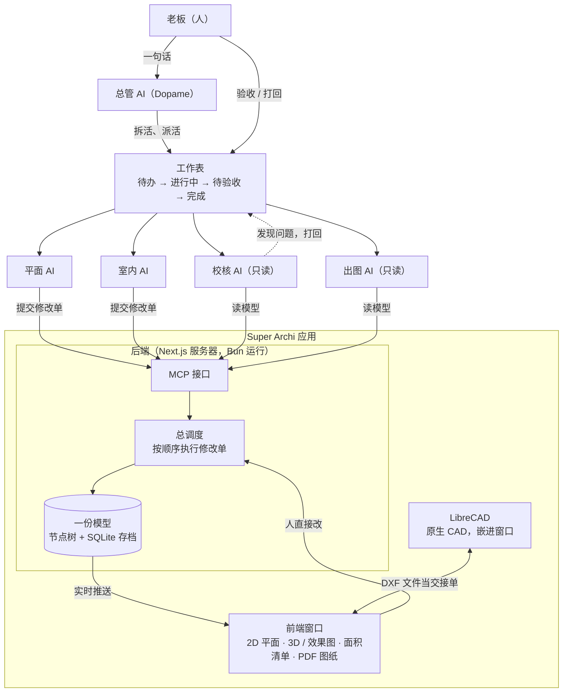

# Super Archi · 建筑师的 Computer AI

> **BoHack 2026**（主题「日新 Renew」）· Return AI 企业赛道 · Dopame OS 应用移植与开发
> **路线**：移植 + 改造。把一款开源的网页版建筑设计软件（BIM）搬进 Dopame OS，再接上系统的 AI 员工和系统能力。
> **文档版本**：2026-11-15

**一句话**：一份建筑模型，平面、3D、效果图、清单、图纸都从它生成；人和多个 AI 员工同时在上面改，改动实时同步给每个人。

---

## 目录

1. [项目进度](#1-项目进度)
2. [为什么做：建筑师的真实痛点](#2-为什么做建筑师的真实痛点)
3. [做了什么：三个支柱](#3-做了什么三个支柱)
4. [使用场景](#4-使用场景)
5. [功能清单](#5-功能清单)
6. [系统架构](#6-系统架构)
7. [多个 AI 怎么分工协作](#7-多个-ai-怎么分工协作)
8. [移植说明（赛题要求）](#8-移植说明赛题要求)
9. [技术栈](#9-技术栈)
10. [和 Revit 有什么不同](#10-和-revit-有什么不同)
11. [路线图：让 AI 员工越用越会干](#11-路线图让-ai-员工越用越会干)
12. [开发、运行与部署](#12-开发运行与部署)
13. [已知限制与风险](#13-已知限制与风险)
14. [交付物](#14-交付物)
15. [许可与致谢](#15-许可与致谢)
16. [附录：名词解释](#附录名词解释)

---

## 1. 项目进度

图例：✅ 已完成　🔧 方案已定，正在实施　⏳ 尚未开始　🎬 概念演示（视频、海报里是示意动画）　🧭 设计理念 / 路线图　❓ 待主办方确认

<!-- 提交前请按实际进度更新本表和第 5、8 节的「状态」列 -->

| 部分 | 状态 | 说明 |
| --- | --- | --- |
| 移植可行性评估 | ✅ | 读完上游源码、Dopame 官方文档（acde 0.0.9）和官方桌面安装包，列出全部不兼容点和改法（第 8 节） |
| Dopame 运行时能力实测 | ✅ | 在 Mac 版运行时 acdert 0.0.11 上实测：WebAssembly、2D 画布、含中文的 SVG 可用；WebGL 不可用；SVG 内嵌 HTML（foreignObject）不显示。后续在 Linux（RTX 4060）上实测：WebGPU 3D 可渲染；不支持 SVG 的「描边不随缩放变粗」（`vector-effect`） |
| 代码移植：打包进 acde，修复不兼容处 | ✅ / 🔧 | 已能打包并安装进 Dopame 运行，3D、2D、项目存取可用，有端到端测试。8.2 的 10 项里 7 项完成、3 项未做，另有 4 项实施中新发现并已解决 |
| CAD 联动：DXF 底图、嵌入 LibreCAD | ⏳ | 方案见 6、8.4；尚未开始写代码 |
| 多 AI 分工、接入 Dopame 工作表 | ✅ / ❓ | 多 AI 分工已在应用内实现，并在 Dopame 上用真实模型跑通：总管拆任务，四个 AI 按顺序逐个执行（尚未并行），校核可打回，人验收或撤回；工作表做在应用自己的侧边栏里。接入 Dopame 系统工作表未做（见 8.5）。设计见第 7 节；路演视频里是概念演示 |
| 三方（设计师、业主、施工方）同时编辑 | 🎬 | 路演视频里是概念演示 |
| 自进化（把 RSI 思路落到应用层） | 🧭 | 见第 11 节，不声称已实现 |
| 路演视频（86 秒）、展位海报（易拉宝 + 4 张 A3） | ✅ | 见第 14 节 |

---

## 2. 为什么做：建筑师的真实痛点

建筑设计的日常流程是一条"接力赛"：

```
CAD 画平面 → SketchUp / Rhino 建模 → Lumion 出效果图 → Excel 算材料
```

问题出在每一棒都要重做：

1. **改一处，改四遍**。平面上挪一面墙，模型、效果图、材料表都要各自手动改一遍。
2. **只能排队干**。建模要等平面定稿，效果图要等模型做完，没法同时推进。
3. **给别人看很麻烦**。业主、施工方要么也装同样的软件，要么等你导出图片和 PDF。
4. **AI 帮不上大忙**。现在的 AI 操作这些软件，只能看截图、猜按钮在哪去点，又慢又容易点错。

---

## 3. 做了什么：三个支柱

> **Computer AI × 应用 ＝ 新的协作范式**

| | 支柱 | 意思 |
| --- | --- | --- |
| 01 | **数据互通** | 一份模型，平面、效果图、清单、图纸全从它生成。改一处，处处跟着变。这和 Revit 里平面视图、三维视图同时开着是一个道理 |
| 02 | **Agent 同时协作** | 总管 AI 派活，几个 AI 员工同时干，改完自己检查，出错能撤回 |
| 03 | **软件连在一起** | 一个链接，设计师、业主、施工方各看各的界面；CAD 软件和 3D 模型通过文件自动联动 |

为什么适合放进 Dopame OS：Dopame 本身就是"总管 + AI 员工 + 工作表"的结构，而我们的应用天生能让 AI 直接读写模型数据，两者对得上。

---

## 4. 使用场景

### 场景 A：一句话，两居改三居

1. 老板说一句：**"两居改三居，主卧朝南，出平面图。"**
2. 总管把活拆成 4 个任务，派到工作表上。
3. 4 个 AI 员工**同时动手**：平面 AI 加墙、开门；室内 AI 摆家具、换材质。
4. 校核员工发现新开的门撞上了衣柜，**打回重改**。
5. 出效果图、PDF 和 CAD 图纸，等老板验收。

整个过程中，每一次修改都实时出现在屏幕上，人随时可以接着改，也可以撤销。

### 场景 B：一个链接，三方各看各的

方案评审时，三个人打开同一个链接，看到的是同一份模型的不同界面：

| 角色 | 看到什么 | 举例改动 |
| --- | --- | --- |
| 业主 | 效果图 | "地板换成胡桃木" |
| 设计师 | 3D 模型 | "客厅窗加宽到 3.4 米" |
| 施工方 | CAD 图和材料表 | "窗台抬到 0.9 米，省一道护栏" |

任何一方改了，另外两方的画面立刻跟着变。

---

## 5. 功能清单

**来源**："上游" = 开源项目本来就有，我们负责移植进 Dopame；"新增" = 比赛期间我们加的。

| 功能 | 来源 | 状态 |
| --- | --- | --- |
| 2D 平面：墙、楼板、屋顶、门窗、房间、轴网、尺寸标注、测量 | 上游 | ✅ 已移植，平面图显示正常；各绘图工具未逐项验证 |
| 3D 视图（WebGPU 显卡渲染） | 上游 | ✅ 已在 Linux（RTX 4060）上验证可用，默认低画质档 |
| 出图：矢量 PDF（平面、基础、吊顶、屋顶、总平面图），从模型生成立面 | 上游 | 🔧 未在 Dopame 上验证 |
| 导入导出：IFC（BIM 通用格式）、GLB（3D 模型）、JSON | 上游 | 🔧 JSON 导入导出已通过端到端测试；IFC、GLB 未验证 |
| 撤销重做（50 步）、保存时的版本冲突检测 | 上游 | 🔧 版本冲突检测已通过端到端测试；撤销重做未单独验证 |
| AI 接口（MCP）：读写模型、平面图照片识别成墙和房间、AI 改动实时推送到编辑器 | 上游 | ✅ 读写模型、实时推送已通过端到端测试；照片识别未验证 |
| 按真实太阳位置画阳光和阴影（按日期、经纬度、指北方向） | 上游 | 🔧 未在 Dopame 上验证 |
| 中文界面 | 上游 | 🔧 AI 侧边栏已是中文；其余界面大部分仍显示英文（译文待人工审核） |
| **DXF 导入当底图**，从"墙"图层一键识别成墙；**导出 DXF** | 新增 | ⏳ |
| **嵌入 LibreCAD**，在应用里直接打开、修改真实的 CAD 图 | 新增 | ⏳ 只在 Dopame OS 上可用 |
| CAD 与模型联动：DXF 文件当"交接单"，一边改完另一边自动更新 | 新增 | ⏳ |
| 多 AI 分工：总调度 + 平面 / 室内 / 校核 / 出图四个 AI | 新增 | ✅ 应用内已实现：总管拆任务，四个 AI 按顺序执行；🎬 同时动手仍是概念演示 |
| 接入 Dopame 工作表：一键派活，做完回到应用里验收或打回 | 新增 | ❓ 未接入，工作表目前做在应用内；依赖桌面服务能否开放 |
| 系统集成：双击 .dxf / .ifc 直接打开、桌面菜单栏、全局快捷键、窗口全屏、平面 / 3D / CAD 分三个窗口并排 | 新增 | 🔧 窗口全屏已完成；其余 ⏳ |
| 界面对 AI 友好：每个按钮都有清楚的文字名，系统总管能直接"看懂、点动" | 新增 | 🔧 |

---

## 6. 系统架构



**三个关键点**

1. **只有一份模型**。平面图和 3D 是同一个页面里的两个窗格，读的是同一份数据。在平面上拖墙，3D 自动跟着变，这一步不需要 AI，是软件自己完成的。
2. **AI 按任务分工，不按视图分工**。视图是给人看的；AI 不看画面，直接读写模型数据。
3. **CAD 用 DXF 文件交接**。在 LibreCAD 里改图、保存，应用每隔一两秒检查文件的修改时间，发现变了就重新导入，底图和识别出的墙随之更新。反过来，在应用里改了平面，导出 DXF，LibreCAD 重新打开就能看到。写文件时会检测"别人刚改过"，防止两边互相覆盖。

---

## 7. 多个 AI 怎么分工协作

> **当前进度**：已实现的是简化版。总管把一句话拆成任务，四个角色**按顺序逐个执行**，直接用上游的 AI 接口和实时推送；工作表、修改单、验收和撤回都在应用内的侧边栏里。下面设计中的这几点**尚未实现**：自己写的总调度队列、几个 AI 同时出方案、人和 AI 走同一条队列。分工目前靠每个角色只拿到本职的一组工具来实现；出图 AI 目前只报面积表。

### 为什么不能让每个 AI 直接改

上游的 AI 接口会给每个连进来的 AI 各开一个工作区，里面有一份自己的模型副本。保存时核对版本号：别人刚存过，这次保存就会被拒绝。这能防止悄悄覆盖，但几个 AI 同时改同一个项目时，只有先存的算数，后存的要重新加载、重做，谈不上并行。

### 我们的设计："总图负责人"模式

后端放一个我们自己写的**总调度**，手里只有一份模型。

| 角色 | 能改什么 | 干什么 |
| --- | --- | --- |
| 平面 AI | 墙、门窗 | 按要求调整户型 |
| 室内 AI | 家具、材质 | 布置和换材质 |
| 校核 AI | 只读 | 查碰撞、算面积、测量，发现问题就打回 |
| 出图 AI | 只读 | 导出 PDF、DXF 和效果图 |

- AI 们**同时思考、同时出方案**。要改模型时，把"修改单"交给总调度，由它按顺序一条条执行（每条只要几毫秒），再实时推送给编辑器和其他 AI。
- **分工防冲突**：每个 AI 只能改自己负责的构件类型或楼层。
- **人和 AI 走同一条队列**：人在界面上的修改也是一张修改单，随时能插手、能撤销。
- **直接复用上游已有的零件**：修改工具（apply-patch）、版本冲突检测、实时推送（live-sync）。
- **AI 的大脑**：比赛提供的 OpenAI 兼容接口。每个 AI 就是一段带不同角色说明的对话，加上一套 MCP 工具。

### 和 Dopame 的对应关系

| Dopame 系统里 | Super Archi 里 |
| --- | --- |
| 总管 | 接收老板的一句话，拆成任务 |
| AI 员工 | 平面 / 室内 / 校核 / 出图四个角色 |
| 工作表（待办 → 进行中 → 待验收 → 完成） | 每个任务的进度；老板"验收"或"打回重做" |
| AI 工作账本（agentrt） | 记录每张修改单：谁改的、为什么改 |

### AI 操作数据，而不是点按钮

| 我们的做法 | 传统软件 |
| --- | --- |
| AI 直接说"把 window_07 加宽到 2.4 米"，或者问"给我所有朝南的窗" | AI 看截图、找按钮，又慢又容易点错 |
| 自带碰撞、测量、场景校验工具，AI 改完自己检查 | 改完靠人一点点看 |
| 有撤销和版本冲突检测，AI 改错了能退回 | AI 闯了祸很难收拾 |
| 几个 AI 分工，同时干 | 一个 AI 从头干到尾 |
| 效果图、PDF、CAD 一次出齐 | 换三个软件各做一遍 |

---

## 8. 移植说明（赛题要求）

> 赛题要求：项目说明附"移植说明"，写清上游项目、改了什么、换掉了哪些依赖、用了哪些系统能力。上游代码按第三方代码申报。

### 8.1 上游项目

| 项目 | 内容 |
| --- | --- |
| 名称 | Pascal Editor（开源网页版 BIM 编辑器） |
| 仓库 | <https://github.com/pascalorg/editor> |
| 版本 | `main` 分支提交 `559c0d1`（2026-11-14），对应 `@pascal-app/*` 1.1.4 |
| 协议 | MIT，保留原 LICENSE（Copyright (c) 2026 Pascal Group Inc.） |
| 知名度 | GitHub 约 2.5 万星（2026-11-14 查看） |
| 形态 | Next.js 全栈网页应用（带服务器）+ 多包仓库（Turborepo 管理的多个内部包） |
| 我们的仓库 | <https://github.com/chenqihao91/editor>，fork 自上游，保留全部提交历史 |

**为什么选它**

- 它是 BIM：一份模型生成所有视图，正好解决"改一处改四遍"。
- 自带 AI 接口（MCP），AI 改的是数据，适合"AI 电脑"。
- 带服务器的全栈应用，Dopame 能把它的服务器直接当应用后端，不是"纯网页打包"。
- MIT 协议，允许修改和再发布。

### 8.2 改了什么

| # | 问题 | 原因：Dopame 不支持什么 | 改法 | 涉及位置 | 状态 |
| --- | --- | --- | --- | --- | --- |
| 1 | 3D 视图 | 运行时没有 WebGL；WebGPU 只在 Dopame OS（Linux）上有 | 保留 WebGPU 渲染；Mac 上 3D 画布会自动卸下、不会崩溃，2D 照常工作；3D 在 Linux 机器上验证 | `packages/viewer/src/components/viewer/index.tsx` | ✅ 已在 Linux 上验证 |
| 2 | 145 个家具模型里有 98 个是 Draco 压缩格式 | 解压器要用 Web Worker（后台线程） | 构建前一次性解压（实际用的是 three.js 自带的 Draco 解码器，没有引入 gltf-transform），页面上不再需要解压器 | `packages/nodes/src/item/renderer.tsx`、`apps/editor/public/items/` | ✅ |
| 3 | 访问检查只放行 `localhost` | Dopame 里页面地址是 `acde.local`，会被当成外网访问 | 设置 `PASCAL_AUTH=proxy`，或把 `acde.local` 加进放行名单 | `apps/editor/lib/self-host-auth.ts` | ✅ |
| 4 | 画墙时输入长度的小框、测量标签不显示 | SVG 里嵌 HTML（foreignObject）不渲染 | 改成浮在画面上方的普通 HTML 层 | `floorplan-placement-typing-hud.tsx`、`floorplan-measurement-tool-layer.tsx` | ⏳ |
| 5 | 项目缩略图、截图 | 不支持 OffscreenCanvas、createImageBitmap | 改用普通 2D 画布 | `thumbnail-generator.tsx`、`viewer/src/lib/snapshot-pipeline.ts`、`point-ask/capture-crop.ts` | ✅ |
| 6 | "几何脚本""3D 打印外壳"两个功能 | 要用 Web Worker；页面端的 `crypto.subtle` 也只有这里用到 | 原计划在界面上隐藏；实际没有隐藏，改成在页面线程运行，哈希换成纯 JS 的 SHA-256 | `editor/src/lib/geometry-script/`、`print-shell-compiler-*` | ✅ |
| 7 | 漫游、无人机视角 | 不支持锁定鼠标（Pointer Lock） | 原计划先隐藏；实际已改成按住拖拽转视角 | `live-walkthrough-controller.tsx` 等 3 个文件 | ✅ |
| 8 | 全屏按钮 | 不支持浏览器全屏 API | 换成 Dopame 窗口全屏（`acde:window`） | `command-palette/editor-commands.tsx` | ✅ |
| 9 | 云端功能：Mint 登录、官方托管 AI、公开分享链接 | 依赖上游的线上服务 | 关闭，改为本地后端 + 比赛提供的 AI 接口 | `apps/editor/app/api/plugins/mint/` 等 | 🔧 本地后端和 OpenAI 兼容接口已接通；Mint 插件尚未关闭 |
| 10 | 第三方插件"浴室""景观"（来自 pascal-cluster 仓库） | 该仓库没有写许可证，默认不能随便用 | 移除 | 插件配置 | ⏳ 尚未移除 |
| 11 | 2D 平面图糊成色块（实施中发现） | 不支持 SVG 的「描边不随缩放变粗」，细线被放大几十倍 | 在不支持的环境里按当前缩放换算线宽 | `packages/editor/src/lib/floorplan/non-scaling-stroke.ts` | ✅ |
| 12 | 材质贴图是 KTX2 压缩格式（实施中发现） | 解码要用 Web Worker | 构建前转成 WebP | `apps/editor/scripts/acde/` | ✅ |
| 13 | 图标、打印编译模块从外网加载（实施中发现） | 不能从 CDN 加载模块，也访问不了图标接口 | 构建时打进应用自带的资源 | `apps/editor/scripts/acde/` | ✅ |
| 14 | 3D 画布改变大小时整块变白约一秒（实施中发现） | 不是运行时缺能力：后处理管线在每次尺寸变化时重建 | 只在画布从无尺寸变为有尺寸时重建 | `packages/viewer/src/components/viewer/post-processing.tsx` | ✅ 只在低画质档验证过 |

### 8.3 换掉或去掉的依赖

| 原来用的 | 换成 | 原因 |
| --- | --- | --- |
| Draco 解码器（DRACOLoader） | 构建前预解压的 GLB 模型 | 解码器依赖 Web Worker |
| OffscreenCanvas / createImageBitmap | 普通 2D 画布 | 运行时不支持 |
| SVG foreignObject | 普通 HTML 浮层（尚未实施） | 运行时不渲染 |
| 浏览器 Fullscreen API | `acde:window` 窗口全屏 | 运行时不支持 |
| WebGL 回退渲染 | 只走 WebGPU（Dopame OS） | 运行时没有 WebGL |
| Web Worker 相关功能（几何脚本、3D 打印外壳） | 改在页面线程运行（原计划隐藏） | 运行时不支持 Web Worker |
| Pointer Lock（漫游视角） | 按住拖拽转视角（已完成） | 运行时不支持 |
| Mint 登录、官方托管 AI | 本地后端 + 比赛的 OpenAI 兼容接口（Mint 插件尚未关闭） | 不依赖上游线上服务 |

### 8.4 新增的依赖

| 依赖 | 用途 | 协议 | 说明 |
| --- | --- | --- | --- |
| `@dopame/acde-api` 0.0.11 | 调用 Dopame 系统能力 | Return AI 提供 | 官方 SDK |
| dxf-parser | 读 DXF（CAD 图纸） | MIT | 纯网页代码；尚未引入 |
| @dxfjs/writer | 写 DXF | MIT | 纯网页代码；尚未引入 |
| LibreCAD | 在应用里打开、修改真实 CAD 图 | GPL-2.0 | 系统里的独立原生程序，通过 `acde:launch` 嵌进窗口，**不打包进应用**；尚未接入 |
| @modelcontextprotocol/client | 应用后端在进程内调用自带的 AI 接口（MCP） | Apache-2.0 | 已引入到编辑器应用；上游的命令行工具和测试里本来就在用 |

### 8.5 用了哪些系统能力

| 系统能力 | 用来做什么 | 状态 |
| --- | --- | --- |
| 应用后端（Bun / Node.js） | 上游的 Next.js 服务器整体作为应用后端：保存项目（SQLite）、AI 接口（MCP）、总调度 | ✅ 保存项目、AI 接口已可用；总调度未单独实现（见第 7 节） |
| `acde:fs` 文件 | 读写 DXF、IFC 和项目文件；存到系统"文档"文件夹，别的应用和 AI 也能用；按修改时间检测 DXF 变化；写入防覆盖 | ⏳ 已声明权限，尚未使用 |
| `acde:launch` 启动 / 嵌入原生程序 | 把 LibreCAD 嵌进应用窗口（官方浏览器应用也是这样嵌入 Firefox 的） | ⏳ 只在 Dopame OS 上有 |
| `acde:open` 文件关联与请求 | 双击 .dxf / .ifc 用本应用打开；接收别的应用发来的"打开这张平面图"请求 | ⏳ |
| `acde:window` 窗口 | 桌面菜单栏菜单、全局快捷键、窗口全屏、多窗口（平面 / 3D / CAD 分窗口） | 🔧 窗口全屏已完成；其余 ⏳ |
| WebGPU | 3D 视图和效果图 | ✅ 3D 视图已在 Linux 上验证；只在 Dopame OS 上有 |
| 语义树（`acde:inspect`） | 界面元素都有文字名，系统总管能 look（看）/ act（点、打字）直接操作应用；也用来做自动化测试 | 🔧 端到端测试已按按钮名称操作界面；未做完整检查 |
| OpenAI 兼容 AI 接口 | 各角色 AI 的大脑；平面图照片识别 | ✅ 角色 AI 已接通：应用内可填任意 OpenAI 兼容接口，已用一个第三方接口实测跑通；照片识别未做。❓ 主办方接口的地址和额度仍待确认 |
| 桌面服务 `desk` / `assistant` | 往工作表派活、看进度、验收 / 打回；和总管对话 | ❓ 未接入。官方桌面自带，但文档没写，第三方能否使用待确认；实测手头这份桌面包的 assistant 服务因缺少后端程序无法启动 |

---

## 9. 技术栈

按"盖楼"的顺序，从地基往上排。版本号来自上游 2026-11-14 的代码。

| 层 | 用什么 | 干什么用 | 来源 |
| --- | --- | --- | --- |
| 运行平台 | Dopame OS + 运行时 acdert；开发工具 acde 0.0.11 | 应用跑在哪里 | — |
| 编程语言 | TypeScript 7 | 带类型检查的 JavaScript | 上游 |
| 网站框架 | Next.js 16.4 + React 19.3 | 页面加服务器 | 上游 |
| 界面 | Tailwind CSS 4、Radix UI、lucide 图标、motion 动画 | 按钮、面板、对话框、动效 | 上游 |
| 数据与撤销 | Zustand 5、Zundo、Zod 4、mitt | 存模型数据、撤销重做、校验数据格式、模块间传消息 | 上游 |
| 3D | three.js 0.187（WebGPU 渲染器）、React Three Fiber 9、Drei 10、three-mesh-bvh、three-bvh-csg | 画 3D、快速点选、在墙上开门窗洞 | 上游 |
| 2D 平面 | SVG（React 组件） | 平面绘制、轴网、尺寸标注、测量 | 上游 / 改 |
| 出图 | PDFKit | 矢量 PDF 图纸 | 上游 |
| 模型格式 | IFC（web-ifc，WebAssembly）、GLB / glTF、JSON | 导入导出 BIM 和 3D 模型 | 上游 |
| CAD | dxf-parser、@dxfjs/writer、LibreCAD | 读写 DXF；编辑真实 CAD 图 | **新增** |
| 后端 | Next.js 服务器，Bun 运行；SQLite（Bun 自带） | 存项目、AI 接口、总调度 | 上游 / 改 |
| 浏览器存储 | IndexedDB | 自动保存当前场景（Dopame 完整支持） | 上游 |
| AI 接口 | MCP（`@modelcontextprotocol/server` + Hono） | AI 读写模型、实时推送 | 上游 |
| AI 大脑 | 比赛提供的 OpenAI 兼容接口 / Dopame `assistant` 服务 | 角色 AI 的思考 | **新增** |
| 系统能力 | `acde:fs`、`acde:launch`、`acde:window`、`acde:open` | 文件、嵌入 CAD、窗口、文件关联 | **新增** |
| 工程工具 | Bun 1.4、Turborepo、Biome、Lingui | 装依赖、多包构建、代码检查、多语言 | 上游 |
| 测试 | `acde test`、`acde inspect`、`acde shot` | 自动点按钮验证、截图检查 | **新增** |

---

## 10. 和 Revit 有什么不同

理念一样：都是 BIM，一个模型、参数联动、图纸从模型里生成。区别在**谁能用、怎么用、AI 能不能进来**。

| | Revit | Super Archi |
| --- | --- | --- |
| 价格 | 按年订阅，很贵 | 开源、免费 |
| 在哪用 | 只能装在 Windows | 浏览器打开，Mac、平板都行；也能作为 Dopame OS 的桌面应用 |
| 文件 | .rvt 私有格式 | 开放数据，别的程序也能读 |
| 接 AI | 要用 C# 写插件 | 自带 AI 接口，AI 直接操作 |
| 给别人看 | 对方也得装 Revit | 发个链接就能看 |

**定位**：施工图仍交给 Revit；方案、户型、室内阶段，用 Super Archi 更快。Revit 在施工图、族库、结构、机电、明细表、多人协同上非常成熟，Super Archi 不替代它。

---

## 11. 路线图：让 AI 员工越用越会干

> 本节是**设计理念和路线图**，尚未实现。我们是把 RSI（AI 自我改进）的思路落到应用层，不声称实现了 RSI。

### 五个层级

| 层级 | 改的是什么 | 举例 | 我们做不做 |
| --- | --- | --- | --- |
| 1. 改结果 | 设计方案 | AI 改一版方案 → 跑日照、面积检查 → 再改一版 | 做 |
| 2. 改知识 | 知识库 | 注入规范、户型库、过往项目 | 做 |
| 3. 改方法 | AI 员工的技能 | 反复成功的做法沉淀成一项"技能" | 做 |
| 4. 改分工 | AI 员工的编制 | 一个员工的活太杂，分化成两个；用不上的员工合并或裁掉 | 做 |
| 5. 改大脑 | 模型本身 | AI 修改自己的模型和代码 | **不做** |

### 谁来当"考官"

AI 能不能变好，要有客观的标准来判。建筑设计天然有考官：碰撞检查、面积计算、规范校验、校核 AI，以及老板在工作表上的验收和打回。模型就是 AI 的练习场，考官给出分数。

### 成长方式：先做加法，再做减法

```
功能 → 沉淀成技能 → 分化出新的 AI 员工 → 修剪不用的
```

- AI 员工是"岗位说明书"，不是一直在跑的程序。系统变重只来自两件事：同时干活的员工太多，或技能堆得太杂。
- 所以设**编制上限**，并定期修剪，就像大脑会修剪不用的神经连接。

### 安全规则

- AI **不能修改考官**（检查规则、验收标准）。
- 新技能、新分工先上**试用期**：用历史案例回放一遍，成绩不降才转正。
- 所有技能和分工都有版本，**随时回滚**。
- 改动组织结构（新增、合并、裁撤员工）**要人批准**。

这也对应本届主题"日新"：软件每天都比昨天更懂你的工作方式。

---

## 12. 开发、运行与部署

### 环境

| 用途 | 机器 | 说明 |
| --- | --- | --- |
| 界面和 2D 开发 | Mac + acde 0.0.11 | Mac 版运行时没有 WebGPU 和 WebGL，3D 区域会自动卸下 |
| 3D、LibreCAD 嵌入验证 | Ubuntu + RTX 4060 + Dopame 镜像 | 先运行 `vulkaninfo --summary` 确认能看到 RTX 4060（Dopame 要求真显卡驱动；虚拟机没做显卡直通则用不上） |
| 最终运行 | 赛事提供的 Dopame OS 云服务器 | 部署方式以主办方说明为准 |

### 常用命令

```bash
acde dev                     # 在 acdert 里运行，改代码自动刷新
acde dev --desktop dopame    # 在官方 Dopame 桌面里运行（用到 desk / assistant 服务时必须）
acde build                   # 打包成 Dopame OS 能直接加载的纯 JS 包
acde install                 # 打包后装到本机
acde inspect                 # 把屏幕打印成语义树，检查 AI 能否看懂界面
acde shot                    # 给窗口截图
acde test                    # 跑端到端测试（*.e2e.ts）
```

### 构建要点

- 上游是多包仓库：先编译编辑器依赖的几个内部包，再打包 `apps/editor`。
- acde 识别到 Next.js 后会自动打包，把它的服务器当应用后端。
- 后端设置环境变量 `PASCAL_AUTH=proxy`（见 8.2 第 3 条）。
- 家具模型先用 gltf-transform 预解压（见 8.2 第 2 条）。
- 上游要求 Bun 1.4.4。acde 0.0.11 不自带 Bun，用的是系统里装的那个，要先装好 1.4.4。

---

## 13. 已知限制与风险

| 风险 | 影响 | 应对 |
| --- | --- | --- |
| Dopame 的 WebGPU 能否完整跑 three.js 的 WebGPU 渲染器：已在 Linux（RTX 4060）上实测，3D 视图可用；中、高画质档未充分验证 | 3D 视图和效果图 | 默认用低画质档 |
| 比赛服务器能否安装 LibreCAD 等原生程序，未知 | CAD 嵌入 | 保底方案：应用内用 DXF 底图"看图" |
| `desk` / `assistant` 桌面服务文档没写，接口可能改 | 工作表派活、和总管对话 | 角色 AI 直接调 OpenAI 兼容接口，不依赖桌面服务也能跑（已按此实现） |
| acdert 对 Tailwind CSS 4 新特性（@layer、oklch、color-mix）的支持，文档没写 | 界面样式 | 实测后按需降级 |
| 窗口默认内存上限 256 MB | 大模型、大图纸 | 已把本应用的上限配置为 2048 MB |
| 定位是方案阶段工具 | 不能出完整施工图 | 施工图交给 Revit |
| 路演视频中的效果图是实时风格化渲染 | 达不到照片级 | 已准备离线光线追踪方案，尚未运行 |

---

## 14. 交付物

赛题要求三件统一提交物（代码仓库、路演 PPT、项目说明），外加 Dopame OS 能加载的打包产物。

| 交付物 | 位置 | 状态 |
| --- | --- | --- |
| 代码仓库（fork 自上游，保留提交历史） | <https://github.com/chenqihao91/editor> | 🔧 我们的改动在本地 `acde` 分支，尚未推送到该仓库 |
| Dopame OS 打包产物（纯 JS 包） | `acde build` 生成；已打包为 `super-archi-dopame-package.tar.gz`（不随代码提交） | ✅ 已能生成，并安装到 Dopame 运行 |
| 路演 PPT | 待补充 | 🔧 |
| 项目说明（含移植说明） | 本文件 | ✅ |
| 路演视频（86 秒，1080p，字幕 + 背景音乐） | `路演视频/路演视频-最新版.mp4` | ✅ |
| 展位海报：易拉宝 80×180 cm + 4 张 A3 | `海报/`（矢量 PDF、CMYK、PNG、JPG） | ✅ |

### 资料目录

代码仓库（`main` 分支是上游代码的快照，`acde` 分支是我们的改动）：

```
pascal-editor/
├── docs/
│   ├── SuperArchi-项目说明.md       本文件
│   └── dopame-port.zh-CN.md        移植的技术细节、踩过的坑、自进化设计
├── apps/editor/                    编辑器应用，打包成 Dopame 应用
│   ├── acde.config.jsonc           Dopame 应用配置
│   ├── lib/acde/                   Dopame 下的后端环境、语言、页面配置
│   ├── scripts/acde/               构建前的资源准备、AI 接口入口
│   ├── lib/agent/                  多 AI 分工的后端
│   ├── components/agent-panel.tsx  AI 侧边栏（总管、工作表、修改单）
│   └── e2e/                        在 Dopame 里跑的端到端测试
├── packages/                       上游的内部包
│   ├── core/                       模型数据、校验、AI 工具的定义
│   ├── viewer/                     3D 视图
│   ├── editor/                     编辑界面、2D 平面图
│   ├── nodes/                      墙、门窗、家具等各类构件
│   └── mcp/                        AI 接口（MCP）
└── scripts/check-acde-compat.ts    拦截 Dopame 不支持的网页功能
```

仓库之外的资料（不随代码提交）：

```
金客松/
├── Pascal迁移评估.md               移植评估与方案（第 8 节的底稿）
├── Dopame-OS-深读与新形态设计.md    Dopame 系统能力深读
├── acde与SDK开发流程讲解.md         开发工具入门
├── Return-AI-Dopame-OS-赛题.md     赛题
├── 路演视频/                       成片、动画源码、生成脚本（说明.md）
└── 海报/                           海报成品（打印说明.md）
```

---

## 15. 许可与致谢

- **上游**：Pascal Editor，MIT 协议，Copyright (c) 2026 Pascal Group Inc.。本项目保留原 LICENSE，并沿用 MIT 协议。
- **第三方**：three.js（MIT）、dxf-parser（MIT）、@dxfjs/writer（MIT）、LibreCAD（GPL-2.0，作为系统中的独立程序调用，不随应用分发）。
- **平台**：Dopame OS、acde、`@dopame/acde-api` 由 Return AI 提供。
- **素材**：路演视频的背景音乐由程序合成；三个角色形象由团队提供。
- 视频和海报中标注"概念演示"的画面为示意动画。

---

## 附录：名词解释

| 名词 | 意思 |
| --- | --- |
| BIM | 建筑信息模型。一个模型里存着墙、门窗、材料等信息，平面、立面、3D、清单都从它生成。Revit 是最常见的 BIM 软件 |
| Dopame OS | Return AI 的"AI 电脑"操作系统。屏幕上有一个总管和若干 AI 员工，用户像老板一样在工作表上派活、验收 |
| acde / acdert | acde 是开发调试工具，acdert 是它带的运行时（让应用跑起来的环境），和 Dopame OS 上的一致 |
| SDK | 软件开发工具包。这里指 `@dopame/acde-api`，应用通过它调用系统能力 |
| MCP | 一种让 AI 调用软件功能的通用接口，可以理解成"给 AI 用的遥控器" |
| Agent | 能自己拆解任务、调用工具去完成的 AI，这里就是"AI 员工" |
| 语义树 | 系统把屏幕转成的一份文字版目录，每个按钮、输入框都有名字和编号。系统 AI 靠它看懂并操作软件 |
| WebGPU / WebGL | 让网页调用显卡画 3D 的两种技术。Dopame 只支持 WebGPU，且只在 Linux 上有 |
| Web Worker | 网页的"后台帮手"，把重活放到另一条线程做。Dopame 不支持 |
| DXF / DWG | CAD 图纸格式。DWG 是 AutoCAD 的私有格式；DXF 是公开的交换格式，AutoCAD 可以另存为 DXF |
| IFC | BIM 模型的通用交换格式，不同 BIM 软件之间靠它互通 |
| fork | 在 GitHub 上把别人的项目复制一份到自己名下，保留原来的全部修改记录 |
| RSI | Recursive Self-Improvement，AI 自我改进。本项目只借用它的思路，不声称实现 |
